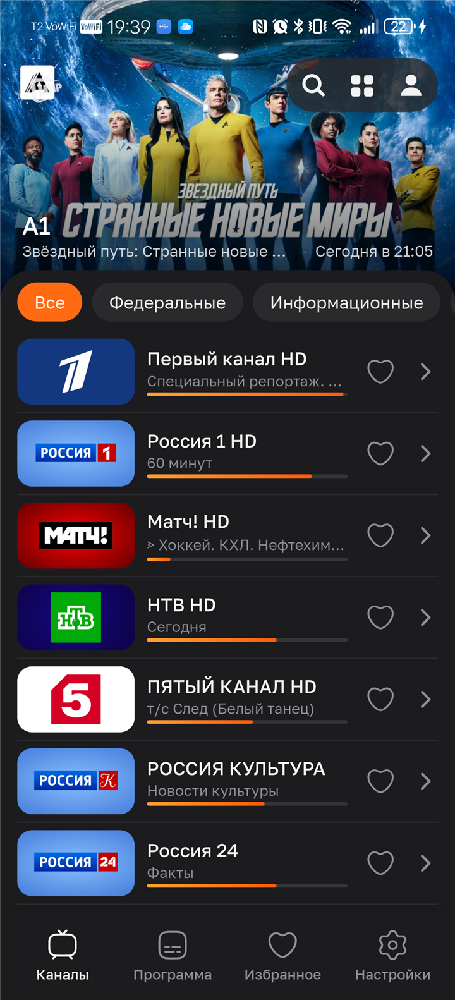
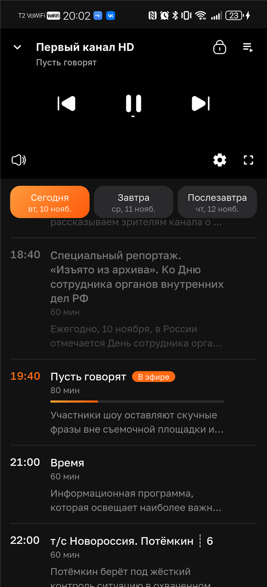
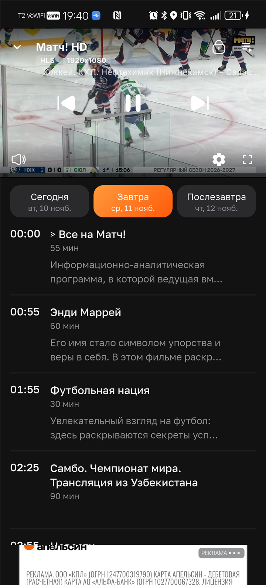

# ТВ МИР - TVMir

**Телевидение в твоём телефоне: 1600+ каналов, программа передач и несколько потоков на каждый канал.**

---

## 📺 Что это

«ТВ Мир» — плеер для просмотра телеканалов на Android. Каналы собираются из открытых источников и уже разложены по категориям: открываешь приложение и смотришь, без плейлистов, регистраций и настроек.

**Скачать:** [RuStore →](https://www.rustore.ru/catalog/app/com.borz.tvmir)

---

## 🖼 Как выглядит

<table>
<tr>
<td></td>
<td></td>
<td></td>
</tr>
<tr>
<td align="center">Каналы и анонсы</td>
<td align="center">Плеер и программа</td>
<td align="center">Управление просмотром</td>
</tr>
</table>

---

## ⚡️ Главное

**Несколько потоков на один канал.** У большинства каналов есть резервные источники. Если один перестал работать — переключаешься на другой прямо в плеере, не закрывая канал.

**«Запомнить поток».** Приложение запоминает рабочий источник и в следующий раз открывает канал сразу с него.

**Программа передач.** Что идёт сейчас и что будет дальше — по каждому каналу, с прогрессом.

**Напоминания о передачах.** Уведомление придёт за 5 минут до начала — для подписчиков.

**Удобное управление.** Свайпы для громкости и яркости, мини-плеер, переключение каналов стрелками, автоповорот на весь экран.

**Тёмная и светлая темы, PIN для 18+.**

---

## 📲 Установка

1. Открой [страницу приложения в RuStore](https://www.rustore.ru/catalog/app/com.borz.tvmir).
2. Нажми «Установить».
3. Открой приложение — каналы уже на месте.

Требования: Android 7.0 и новее, интернет.

---

## 💎 Бесплатно и подписка

Приложение **бесплатное**: все каналы доступны сразу, показывается реклама.

Есть необязательная подписка **99 ₽/мес**:

- без рекламы;
- качество HD+;
- напоминания о передачах;
- просмотр на всех ваших устройствах.

Оплата разовая, без автопродления — продлеваешь сам, когда удобно.

---

## ❓ Коротко о частом

**Зачем это, если есть обычный IPTV-плеер?**
Обычному плееру нужен плейлист, и когда поток отваливается — начинается поиск нового. Здесь каналы уже собраны, а резервные потоки переключаются в один тап.

**Есть гарантии качества каналов?**
Нет. Потоки не наши, они из открытых источников — поэтому и сделано несколько источников на канал. Если не работает ни один, напишите нам, проверим.

**Нужен аккаунт?**
Для просмотра — нет. Аккаунт нужен только для подписки: она привязана к почте и работает на всех устройствах.

**Можно предложить свой канал?**
Да, пишите в Telegram — добавим, если поток рабочий.

---

## 📺 ТВ МИР на большом экране

Готовим версию для телевизоров: управление с пульта, крупный интерфейс и всё то же, что в телефоне — каналы, несколько потоков, программа передач.

**Версия для ТВ выйдет в ближайшее время.** Как только будет готова — сразу напишем в Telegram: там же появятся скриншоты, инструкция по установке и список поддерживаемых устройств.

Следить за новостями: [@tvmirapp](https://t.me/tvmirapp)

---

## 💬 Связь

- Telegram: [@tvmirapp](https://t.me/tvmirapp)
- RuStore: [страница приложения](https://www.rustore.ru/catalog/app/com.borz.tvmir)

---

## ⚠️ Важно

«ТВ Мир» не является оператором связи и не транслирует каналы самостоятельно. Приложение лишь воспроизводит потоки, доступные в открытых источниках. Права на контент принадлежат их владельцам.

---

© ТВ Мир · Приятного просмотра 🧡

